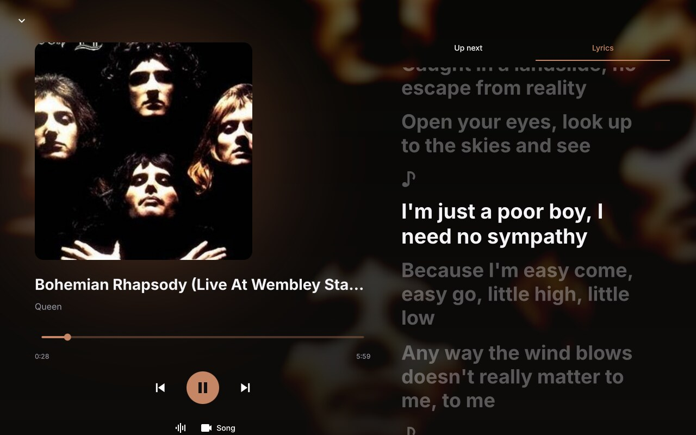
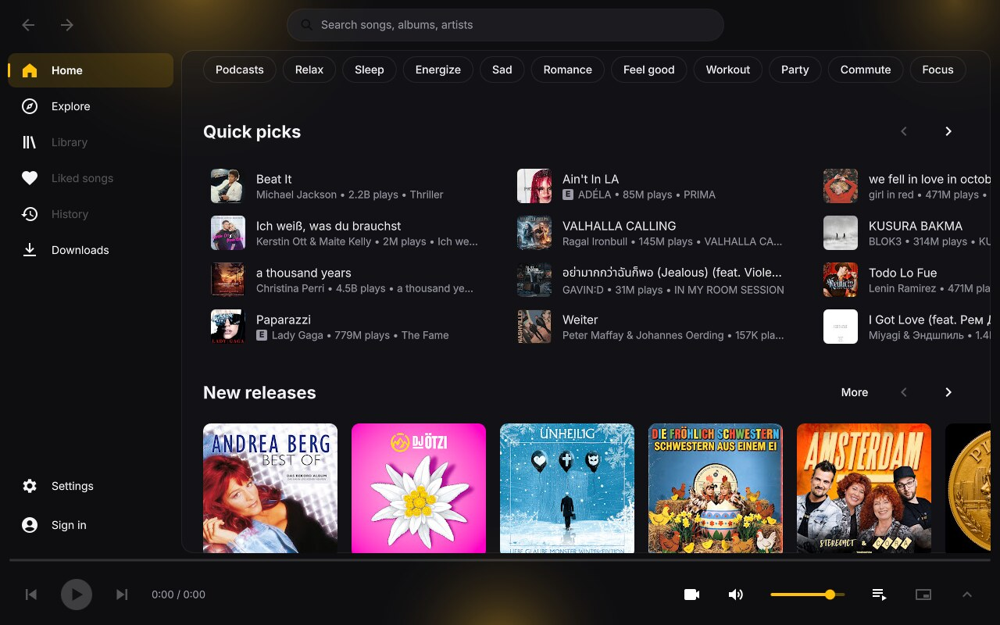
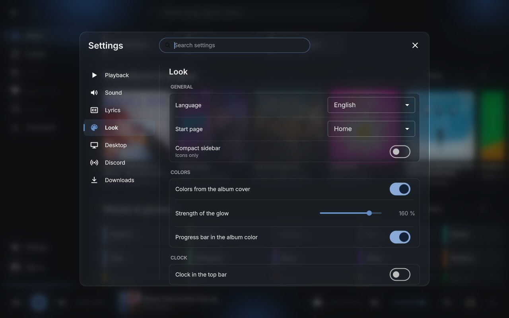

<p align="center">
  
</p>

<h1 align="center">Quince</h1>

<p align="center">
  A fast, native player for YouTube Music.<br>
  Qt and libmpv instead of Electron: a track starts about 0.4 s after the click.
</p>

<p align="center">
  <a href="https://github.com/Blackwolf1337/quince/releases/latest"></a>
  
  <a href="LICENSE"></a>
</p>

<p align="center">
  <a href="#install">Install</a> ·
  <a href="#features">Features</a> ·
  <a href="#getting-started">Getting started</a> ·
  <a href="#shortcuts">Shortcuts</a> ·
  <a href="#documentation">Docs</a>
</p>

<p align="center">
  
</p>

Quince is an alternative to Pear Desktop and the web app. There is no Electron and no yt-dlp. While playing it uses about 270 MiB of memory on the author's machine, against about 800 MiB for Pear Desktop.

Unofficial, not affiliated with Google or YouTube.

## Features

<table>
  <tr>
    <td width="50%" valign="top">
      <h3> Browse</h3>
      Home, Explore, search with suggestions and filters, album, artist and playlist pages. Sign in with Google for your library, liked songs and history.
    </td>
    <td width="50%" valign="top">
      <h3> Play</h3>
      Gapless playback or a crossfade of 1 to 12 s. A queue with play next, radio and add to playlist. The last queue comes back on start. Premium accounts get 256 kbit/s Opus.
    </td>
  </tr>
  <tr>
    <td valign="top">
      <h3> Lyrics</h3>
      Time-synced lyrics from several sources, with four line effects. Japanese, Korean and Chinese lyrics get Latin letters under the lines.
    </td>
    <td valign="top">
      <h3> Watch</h3>
      A Now Playing view with a large cover. Video mode from 360p to 2160p with captions, a visualizer when no video plays, and a mini player.
    </td>
  </tr>
  <tr>
    <td valign="top">
      <h3> Sound</h3>
      Equalizer, compressor, playback speed, skip silences and the choice of the output device. SponsorBlock skips the parts of music videos without music.
    </td>
    <td valign="top">
      <h3> Download</h3>
      Tracks, albums and playlists as Opus, M4A or MP3, with tags and cover.
    </td>
  </tr>
  <tr>
    <td valign="top">
      <h3> Look</h3>
      A dark theme lit by the album's color. English and Deutsch.
    </td>
    <td valign="top">
      <h3> Desktop</h3>
      Discord Rich Presence, tray icon and notifications. MPRIS and system-wide shortcuts on Linux.
    </td>
  </tr>
</table>

All options are listed in [docs/features.md](docs/features.md).

<table>
  <tr>
    <td width="50%"></td>
    <td width="50%"></td>
  </tr>
  <tr>
    <td align="center"><sub>Home</sub></td>
    <td align="center"><sub>Settings</sub></td>
  </tr>
</table>

## Install

Downloads are on the [releases page](https://github.com/Blackwolf1337/quince/releases).

| System | Download | |
|---|---|---|
| Windows (64-bit) | [Windows zip](https://github.com/Blackwolf1337/quince/releases/latest) | Portable: unzip anywhere and run `quince.exe` in the `Quince` folder. |
| macOS (Apple Silicon) | [macOS zip](https://github.com/Blackwolf1337/quince/releases/latest) | Unzip and move Quince.app to Applications. |
| macOS with Homebrew | [see below](#homebrew) | Builds from source with Homebrew's Qt and mpv. |
| Arch Linux, EndeavourOS | [Arch tarball](https://github.com/Blackwolf1337/quince/releases/latest) | Files under usr/, built against Arch's libraries of the release day. No AUR package yet. |
| Other Linux | [build from source](docs/building.md) | |

On Windows the exe is not code-signed, so SmartScreen may warn on the first start ("More info", then "Run anyway"). The sign-in window needs Microsoft Edge WebView2, which Windows 10 and 11 ship.

On macOS the app is not notarized, so the first start is blocked. Open System Settings, Privacy & Security, and click "Open Anyway" (or right-click the app and choose Open).

### Homebrew

```
brew tap blackwolf1337/quince
brew install quince
ln -sf "$(brew --prefix quince)/Quince.app" ~/Applications/Quince.app
```

The last line links the app once, so Launchpad and Spotlight find it. The command `quince` also starts it.

## Getting started

Start Quince. The home page loads from a cache and shows after about 0.7 s. On Windows the very first start can take a while, later starts take about a second.

You can play without an account. To use your library, liked songs and history, use "Sign in" in the sidebar. There are three ways.

1. "Sign in with Google": a small separate window opens Google's sign-in. When it reaches YouTube Music, it hands the session to Quince and closes. It uses the web view of the system. On Linux it needs WebKitGTK 6 and is missing in builds made without it.
2. Take the session of a browser where you are already signed in. The Firefox family works on all systems. The Chromium family works on Linux (on macOS it is written but untested), not on Windows.
3. Import a cookies.txt file (Netscape format).

Sign out in the same place. More details are in [docs/usage.md](docs/usage.md).

Search or pick something on the home page and click a track. Click the cover or title in the player bar to open the Now Playing view. Right-click a track for the menu. Settings has the sound, look, lyrics, download and language options.

## Shortcuts

| Keys | Action |
|---|---|
| <kbd>Space</kbd> | play or pause |
| <kbd>Ctrl</kbd> + <kbd>←</kbd> / <kbd>→</kbd> | previous, next |
| <kbd>Ctrl</kbd> + <kbd>↑</kbd> / <kbd>↓</kbd> | volume |
| <kbd>M</kbd> | mute |
| <kbd>Ctrl</kbd> + <kbd>F</kbd> or <kbd>/</kbd> | search |
| <kbd>Alt</kbd> + <kbd>←</kbd> or the mouse back button | back |
| <kbd>Alt</kbd> + <kbd>→</kbd> or the mouse forward button | forward |
| <kbd>Ctrl</kbd> + <kbd>L</kbd> | lyrics |
| <kbd>Ctrl</kbd> + <kbd>P</kbd> | Now Playing view |
| <kbd>Esc</kbd> | close the Now Playing view |
| <kbd>Ctrl</kbd> + <kbd>Shift</kbd> + <kbd>M</kbd> | mini player |

Media keys work while the window has focus, and on Linux system-wide through MPRIS. Global shortcuts on Linux are described in [docs/usage.md](docs/usage.md).

## Troubleshooting

<details>
<summary>Windows warns on the first start</summary>

The exe is not code-signed. Click "More info", then "Run anyway".
</details>

<details>
<summary>macOS blocks the first start</summary>

The app is not notarized. Open System Settings, Privacy & Security, and click "Open Anyway", or right-click the app and choose Open.
</details>

<details>
<summary>Chrome or Edge cookies do not work on Windows</summary>

Chrome encrypts them with app-bound encryption since version 127. Use Firefox, or import a cookies.txt file.
</details>

<details>
<summary>The first start on Windows is slow</summary>

This is expected, later starts take about a second.
</details>

<details>
<summary>YouTube asks to "Sign in to confirm you're not a bot"</summary>

This happens when signed out, especially after many requests, and some tracks then do not play. Sign in or wait for some time.
</details>

<details>
<summary>Playback or pages break after a YouTube change</summary>

Quince depends on YouTube's internal API. See [docs/maintenance.md](docs/maintenance.md) for how the solver and the parser are updated.
</details>

## Documentation

| | |
|---|---|
| [Features](docs/features.md) | every feature and option in detail |
| [Usage](docs/usage.md) | command line, global shortcuts, mini player on Hyprland, sign-in details, files |
| [Building](docs/building.md) | requirements, build, install, Windows and macOS builds |
| [Platforms](docs/platforms.md) | what is tested on which system |
| [Maintenance](docs/maintenance.md) | updating the solver and the parser, development tools |
| [Architecture](docs/architecture.md) | how streaming works and the source layout |
| [Credits](docs/credits.md) | credits and licenses of the parts Quince uses |

## Credits

Quince builds on ytmusicapi, yt-dlp (challenge solver), QuickJS-ng, Inter, MeCab with IPADIC, ICU, LRCLIB, Megalobiz, Genius and SponsorBlock. The full list with licenses is in [docs/credits.md](docs/credits.md).

## License

Quince is licensed under GPL-3.0-or-later (see [LICENSE](LICENSE)). The bundled parts keep their own licenses, as listed in [docs/credits.md](docs/credits.md). The Windows and macOS downloads contain GPL builds of mpv and FFmpeg.
