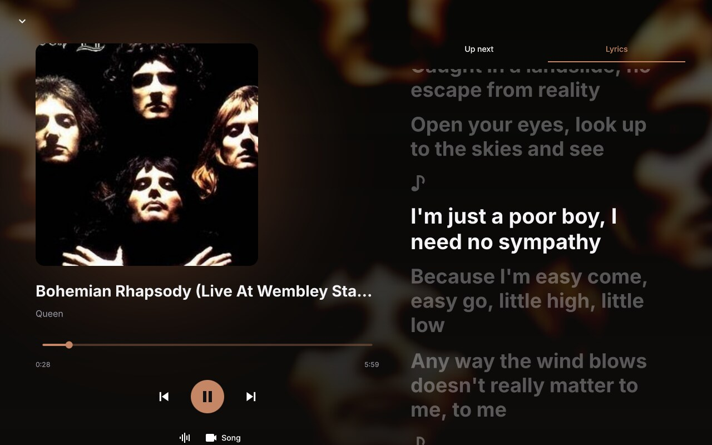

<p align="center">
  
</p>

<h1 align="center">Quince</h1>

<p align="center">
  A fast, native player for YouTube Music.<br>
  Slint, Qt and libmpv instead of Electron: a track starts about 0.4 s after the click.
</p>

<p align="center">
  <a href="https://github.com/Blackwolf1337/quince/releases/latest"></a>
  
  <a href="LICENSE"></a>
</p>

<p align="center">
  <a href="#download">Download</a> ·
  <a href="#building">Building</a> ·
  <a href="#documentation">Documentation</a> ·
  <a href="#contributing">Contributing</a> ·
  <a href="#license">License</a>
</p>

<p align="center">
  
</p>

Quince is an alternative to Pear Desktop and the web app. There is no Electron and no yt-dlp. A track starts about 0.4 s after the click, and playing uses about 270 MiB of memory on the author's machine, against about 800 MiB for Pear Desktop.

Unofficial, not affiliated with Google or YouTube.

## Features

- C++23 with Qt 6 core (network, database, player logic) and a Slint interface.
- Playback through libmpv, gapless or with a crossfade, with equalizer, compressor and speed.
- YouTube Music's internal API is called directly (ytmusicapi's way), with yt-dlp's challenge solver running in QuickJS-ng.
- Home, Explore, search, album, artist and playlist pages, queue, multi-select, library and history when signed in.
- Time-synced lyrics from LRCLIB, Megalobiz, YouTube Music and Genius, with romanization of Japanese, Korean and Chinese.
- Video mode, visualizer and mini player.
- Downloads as Opus, M4A or MP3 with tags and cover.
- Sign-in through the web view of the system, a browser's cookies or a cookies.txt file. A real sign-in was tested on Linux only.
- Media controls: MPRIS on Linux, SystemMediaTransportControls on Windows and Now Playing on macOS. The last two are written but have not been seen on a real Windows PC or Mac.
- Discord Rich Presence, tray icon, notifications, English and German.

The user guide (install notes, sign-in, shortcuts, troubleshooting) is in [docs/guide.md](docs/guide.md).

## Download

Downloads are on the [releases page](https://github.com/Blackwolf1337/quince/releases).

| System | Download | |
|---|---|---|
| Windows (64-bit) | [Windows zip](https://github.com/Blackwolf1337/quince/releases/latest) | Portable: unzip anywhere and run `quince.exe` in the `Quince` folder. |
| macOS (Apple Silicon) | [macOS zip](https://github.com/Blackwolf1337/quince/releases/latest) | Unzip and move Quince.app to Applications. |
| macOS with Homebrew | [see the guide](docs/guide.md#homebrew) | Builds from source with Homebrew's Qt and mpv. |
| Arch Linux, EndeavourOS | [Arch tarball](https://github.com/Blackwolf1337/quince/releases/latest) | Files under usr/, built against Arch's libraries of the release day. No AUR package yet. |
| Other Linux | [build from source](docs/building.md) | |

## Building

Requirements on Arch Linux and EndeavourOS:

```
sudo pacman -S --needed cmake ninja rust qt6-base qt6-tools webkitgtk-6.0 icu mpv ffmpeg fontconfig libglvnd
```

Build and run:

```
git clone https://github.com/Blackwolf1337/quince.git
cd quince
cmake -S . -B build -G Ninja -DCMAKE_BUILD_TYPE=RelWithDebInfo
cmake --build build
./build/quince
```

[docs/building.md](docs/building.md) has the full requirements, the install step, the Windows and macOS builds and the translations.

## Documentation

| | |
|---|---|
| [User guide](docs/guide.md) | install notes, sign-in, shortcuts, troubleshooting |
| [Features](docs/features.md) | every feature and option in detail |
| [Usage](docs/usage.md) | command line, global shortcuts, mini player on Hyprland, sign-in details, files |
| [Building](docs/building.md) | requirements, build, install, Windows and macOS builds |
| [Platforms](docs/platforms.md) | what is tested on which system |
| [Maintenance](docs/maintenance.md) | updating the solver and the parser, development tools |
| [Architecture](docs/architecture.md) | how streaming works and the source layout |
| [Credits](docs/credits.md) | credits and licenses of the parts Quince uses |

## Contributing

Bug reports, ideas and pull requests are welcome. Read [CONTRIBUTING.md](CONTRIBUTING.md) and the [Code of Conduct](CODE_OF_CONDUCT.md) first.

## Security

Report security problems privately, as described in [SECURITY.md](SECURITY.md), never in a public issue.

## Credits

Quince builds on Slint, Qt, mpv, ytmusicapi, yt-dlp (challenge solver), QuickJS-ng, Inter, MeCab with IPADIC, ICU, LRCLIB, Megalobiz, Genius and SponsorBlock. The full list with licenses is in [docs/credits.md](docs/credits.md).

## License

Quince is licensed under GPL-3.0-or-later (see [LICENSE](LICENSE)). The bundled parts keep their own licenses, as listed in [docs/credits.md](docs/credits.md). The Windows and macOS downloads contain GPL builds of mpv and FFmpeg.
