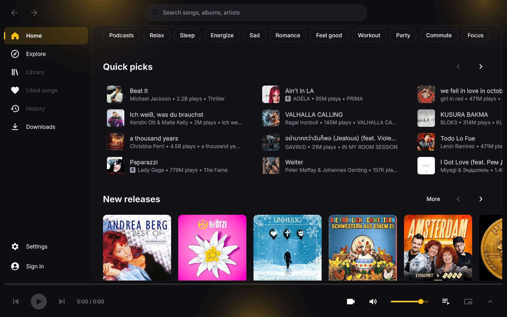
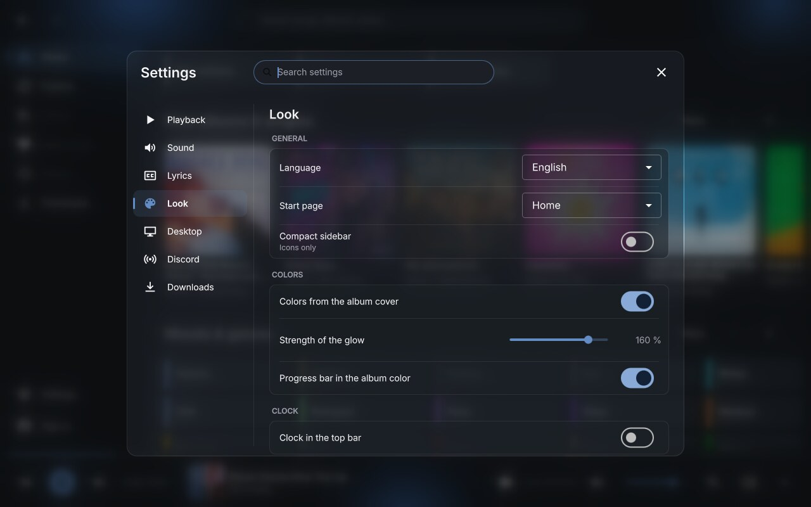

# Quince user guide

Install notes, sign-in, shortcuts and troubleshooting for people who use Quince.

- [Features](#features)
- [Install notes](#install-notes)
- [Getting started](#getting-started)
- [Shortcuts](#shortcuts)
- [Troubleshooting](#troubleshooting)

## Features

<table>
  <tr>
    <td width="50%" valign="top">
      <h3> Browse</h3>
      Home, Explore, search with suggestions and filters, album, artist and playlist pages. Sign in with Google for your library, liked songs and history.
    </td>
    <td width="50%" valign="top">
      <h3> Play</h3>
      Gapless playback or a crossfade of 1 to 12 s. A queue with play next, radio and add to playlist. The last queue comes back on start. Premium accounts get 256 kbit/s Opus.
    </td>
  </tr>
  <tr>
    <td valign="top">
      <h3> Lyrics</h3>
      Time-synced lyrics from several sources, with four line effects. Japanese, Korean and Chinese lyrics get Latin letters under the lines.
    </td>
    <td valign="top">
      <h3> Watch</h3>
      A Now Playing view with a large cover. Video mode from 360p to 2160p with captions, a visualizer when no video plays, and a mini player.
    </td>
  </tr>
  <tr>
    <td valign="top">
      <h3> Sound</h3>
      Equalizer, compressor, playback speed, skip silences and the choice of the output device. SponsorBlock skips the parts of music videos without music.
    </td>
    <td valign="top">
      <h3> Download</h3>
      Tracks, albums and playlists as Opus, M4A or MP3, with tags and cover.
    </td>
  </tr>
  <tr>
    <td valign="top">
      <h3> Look</h3>
      A dark theme lit by the album's color. English and Deutsch.
    </td>
    <td valign="top">
      <h3> Desktop</h3>
      Discord Rich Presence, tray icon and notifications. Media controls: MPRIS on Linux, and written for Windows and macOS (see [platforms.md](platforms.md)). System-wide shortcuts on Linux.
    </td>
  </tr>
</table>

All options are listed in [features.md](features.md).

<table>
  <tr>
    <td width="50%"></td>
    <td width="50%"></td>
  </tr>
  <tr>
    <td align="center"><sub>Home</sub></td>
    <td align="center"><sub>Settings</sub></td>
  </tr>
</table>

## Install notes

The downloads are on the [releases page](https://github.com/Blackwolf1337/quince/releases).

On Windows, unzip the zip anywhere and run `quince.exe` in the `Quince` folder. The exe is not code-signed, so SmartScreen may warn on the first start ("More info", then "Run anyway"). The sign-in window needs Microsoft Edge WebView2, which Windows 10 and 11 ship.

On macOS, unzip and move Quince.app to Applications. The app is not notarized, so the first start is blocked. Open System Settings, Privacy & Security, and click "Open Anyway" (or right-click the app and choose Open).

On Arch Linux and EndeavourOS, the tarball has its files under usr/ and is built against Arch's libraries of the release day. There is no AUR package yet. On other Linux systems, [build from source](building.md).

### Homebrew

```
brew tap blackwolf1337/quince
brew install quince
ln -sf "$(brew --prefix quince)/Quince.app" ~/Applications/Quince.app
```

Homebrew builds Quince from source with its own Qt and mpv. The last line links the app once, so Launchpad and Spotlight find it. The command `quince` also starts it.

## Getting started

Start Quince. The home page loads from a cache and shows after about 0.7 s. On Windows the very first start can take a while, later starts take about a second.

You can play without an account. To use your library, liked songs and history, use "Sign in" in the sidebar. There are three ways.

1. "Sign in with Google": a small separate window opens Google's sign-in. When it reaches YouTube Music, it hands the session to Quince and closes. It uses the web view of the system: WebKitGTK 6 on Linux, WKWebView on macOS and Microsoft Edge WebView2 on Windows. On Linux it is missing in builds made without WebKitGTK 6. A real sign-in was tested on Linux. On Windows and macOS the window is built and Google's page lets it past the email step in CI, but a full sign-in has not been tried there yet.
2. Take the session of a browser where you are already signed in. The Firefox family works on all systems. The Chromium family works on Linux (on macOS it is written but untested), not on Windows.
3. Import a cookies.txt file (Netscape format).

Sign out in the same place. More details are in [usage.md](usage.md).

Search or pick something on the home page and click a track. Click the cover or title in the player bar to open the Now Playing view. Right-click a track for the menu. Settings has the sound, look, lyrics, download and language options.

## Shortcuts

| Keys | Action |
|---|---|
| <kbd>Space</kbd> | play or pause |
| <kbd>Ctrl</kbd> + <kbd>←</kbd> / <kbd>→</kbd> | previous, next |
| <kbd>Ctrl</kbd> + <kbd>↑</kbd> / <kbd>↓</kbd> | volume |
| <kbd>M</kbd> | mute |
| <kbd>Ctrl</kbd> + <kbd>F</kbd> or <kbd>/</kbd> | search |
| <kbd>Alt</kbd> + <kbd>←</kbd> or the mouse back button | back |
| <kbd>Alt</kbd> + <kbd>→</kbd> or the mouse forward button | forward |
| <kbd>Ctrl</kbd> + <kbd>L</kbd> | lyrics |
| <kbd>Ctrl</kbd> + <kbd>P</kbd> | Now Playing view |
| <kbd>Esc</kbd> | close the Now Playing view, or clear the selection |
| <kbd>Ctrl</kbd> + <kbd>A</kbd> | select every track of the page |
| <kbd>Ctrl</kbd> + click / <kbd>Shift</kbd> + click | select tracks (the right-click menu then acts on all) |
| <kbd>Ctrl</kbd> + <kbd>Shift</kbd> + <kbd>M</kbd> | mini player |

Media keys work through MPRIS on Linux. On Windows (media overlay) and macOS (Now Playing) they are written, but have not been seen on a real Windows PC or Mac yet. On Windows, CI saw the media session with the right title and status. See [platforms.md](platforms.md) for details. Global shortcuts on Linux are described in [usage.md](usage.md).

## Troubleshooting

<details>
<summary>Windows or macOS blocks the first start</summary>

See [Install notes](#install-notes).
</details>

<details>
<summary>Chrome or Edge cookies do not work on Windows</summary>

Chrome encrypts them with app-bound encryption since version 127. Use Firefox, or import a cookies.txt file.
</details>

<details>
<summary>YouTube asks to "Sign in to confirm you're not a bot"</summary>

This happens when signed out, especially after many requests, and some tracks then do not play. Sign in or wait for some time.
</details>

<details>
<summary>Playback or pages break after a YouTube change</summary>

Quince depends on YouTube's internal API. See [maintenance.md](maintenance.md) for how the solver and the parser are updated.
</details>

Quince is licensed under GPL-3.0-or-later, see [LICENSE](../LICENSE).
